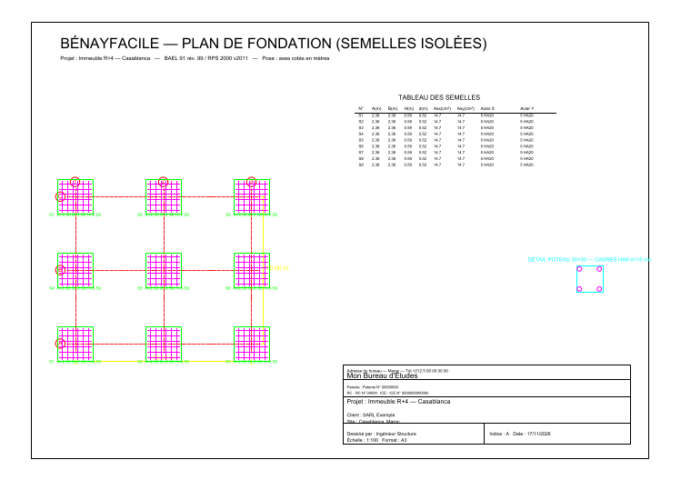

# BÉNAYFACILE

**Le bureau d'études structure marocain, automatisé.**

Bénayfacile calcule vos poteaux, poutres, semelles et voiles selon le
**BAEL 91 révisées 99** et le **RPS 2000 — version 2011**, depuis votre modèle
**Autodesk Robot Structural Analysis**, et génère la **note de calcul** et le
**plan DXF** en quelques clics.



## Ce que BÉNAYFACILE fait pour vous

| Module | Ce que vous obtenez |
|---|---|
| **Poteau** | λ, α (BAEL B.8.4,1), Nu,lim, armatures (min constructif 4 cm²/m), ferraillage, vérification en flexion composée |
| **Vérification sismique** | F = υ·S·D·I·W/K (RPS 2000 v2011, eq. 6.1), période fondamentale, D (Tableau 5.3), répartition verticale Fn |
| **Semelles Isolées / Filantes** | A, B, H (méthode des bielles, h ≥ (A−a)/4), poinçonnement vérifié et H augmenté si besoin, ferraillage (bielles), poids |
| **Poutre** | ELU (diagramme 0,8 yu, μlim 0,392/0,372), non-fragilité, ELS (n = 15, limites A.4.5,33/34), tranchant |
| **Voiles de Contreventement** | σ max/min, armatures de rive si section partiellement comprimée, τu |
| **Synthèse de Calcul** | Note de calcul HTML/PDF A4 : page de garde, références normatives, hypothèses, calculs, **audit arithmétique ligne à ligne** |
| **Données de votre bureau** | Vos coordonnées/ICE/RC reprises dans la page de garde et le cartouche DXF |
| **Modèle Robot** | Extraction via COM (Robot ouvert) ou **mode simulation R+4** pour essayer l'outil sans Robot |

## Qualité et traçabilité

- **Aucune valeur inventée** : chaque constante normative provient des textes
  officiels (tables + articles cités, voir `referentiels/bael.json` et
  `referentiels/rps.json` avec leur `_source`).
- **Audit arithmétique automatique** : chaque ligne de la note est recalculée
  et marquée OK / `ALERTE ECART ARITHMETIQUE`.
- **Données auditées avant émission** : écart = signalé, jamais masqué.
- **100 % local** : écoute sur `127.0.0.1` uniquement — vos données ne sortent
  pas du poste.

## Démarrage rapide

### Sous Windows (poste BET, sans Python)

Lancer `Benayfacile.exe` (voir `build_exe.bat` pour la construction) :
les 5 services démarrent dans un seul processus, le navigateur s'ouvre sur
`http://127.0.0.1:8090`.

### Depuis les sources (développeur)

```bat
pip install -r requirements.txt
run_services.bat          :: lance Robot(8001) Engine(8002) DXF(8003) Rapport(8004) Gateway(8090)
python -m pytest tests/   :: 15 tests
stop_services.bat         :: arrêt propre
```

### Docker (le service Robot y tourne en mode simulation)

```sh
docker compose up --build
```

## Architecture

```
benayfacile_app.py      → lanceur (1 processus, 5 serveurs threads)
launcher/               → AppPaths (Value Object), DataBootstrapper (Strategy),
                          ManagedServer (Adapter), BnayfacileApp (Facade)
services/               → robot_service / engine_service (BAEL+RPS) / dxf_service / report_service
gateway/                → passerelle + tableau de bord web (8 modules)
referentiels/           → bael.json, rps.json (tables officielles) + bureau.json (vos données)
docs/ARCHITECTURE_LANCEUR.md → UML, design patterns, cycle de vie
```

Pilotage Robot : `pywin32` embarqué dans `Benayfacile.exe`. Sans Robot
installé, le mode simulation R+4 (zone 3, site S2, classe II, K = 2,0) permet
de tester toute la chaîne.

## Normes et sources

- **BAEL 91 révisées 99** — Règles techniques de conception et de calcul des
  ouvrages en béton armé (Fascicule 62, titre Iᵉʳ du CCTG, DTU P18-702).
- **RPS 2000 — version 2011** — Règlement de Construction Parasismique
  (Ministère de l'Habitat, Royaume du Maroc).

En cas de divergence entre cet outil et les textes officiels, **les textes
officiels font foi**. Les approximations BET usuelles (méthode des bielles
pour les semelles, armatures minimales des voiles) sont indiquées comme
telles dans la note de calcul et restent sous la responsabilité de
l'ingénieur chargé du projet.

## Auteur

Youssef-AMARZOU — Bénayfacile, bureau d'études structure (Maroc).
https://github.com/Youssef-AMARZOU

© 2026 Bénayfacile. Tous droits réservés. Le code est publié à titre de
présentation commerciale ; il n'est pas librement réutilisable.
