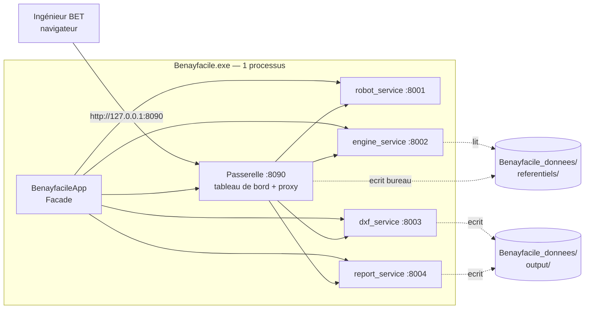
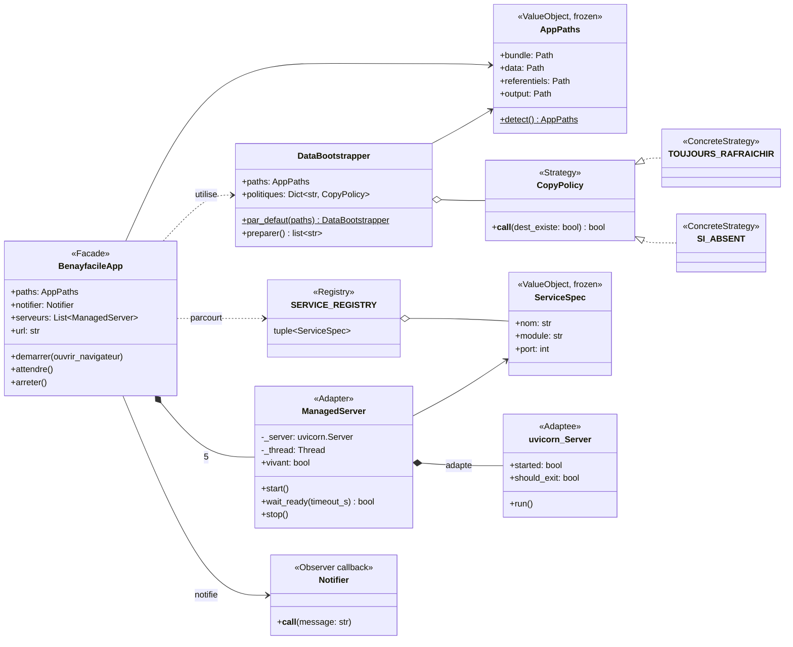
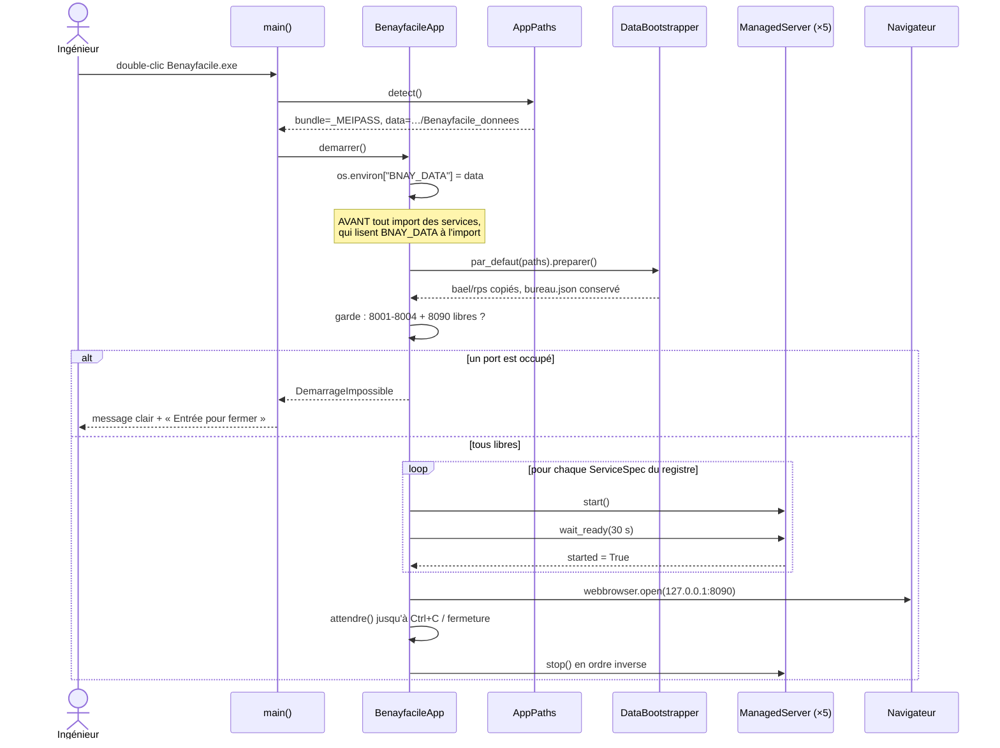
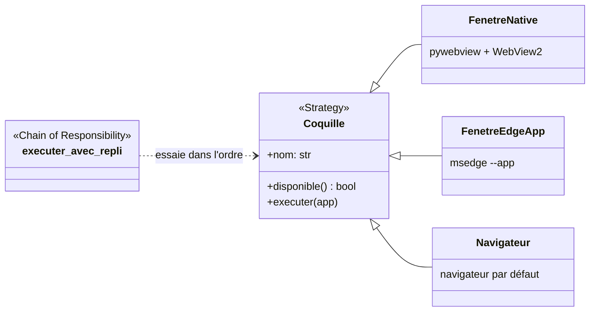
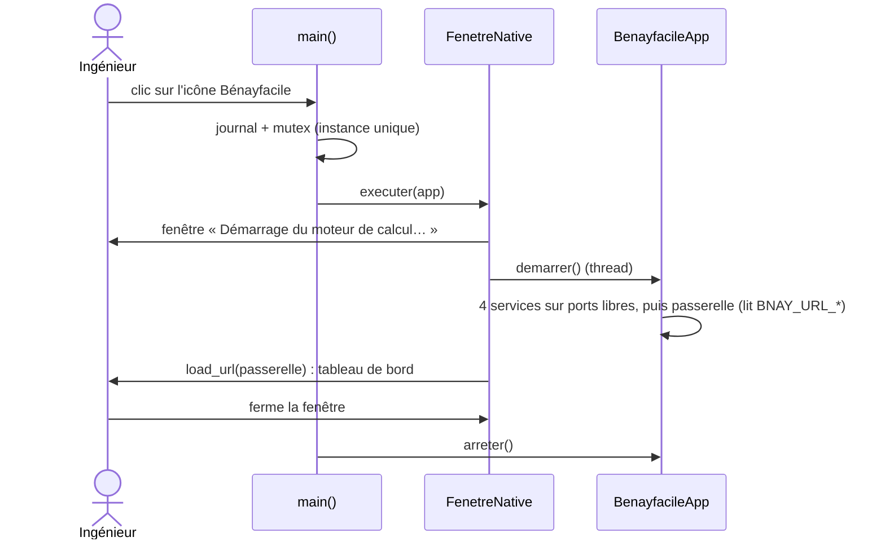

# Benayfacile.exe — architecture du lanceur, design patterns et UML

> Voir aussi docs/CAS_USAGE.md — diagramme de cas d'usage et scénarios détaillés.
> Portée : ce document décrit **le lanceur autonome** (`bnayfacile_app.py` +
> `launcher/`). Le moteur de calcul BAEL/RPS n'est pas modifié ; seule la ligne
> qui localise `referentiels/` et `output/` lit désormais `BNAY_DATA`.

## 1. Le problème à résoudre

Bénayfacile était 5 processus lancés par `run_services.bat` (4 microservices
FastAPI + passerelle). Un `.exe` autonome doit :

1. démarrer les 5 serveurs **sans Python installé** sur le poste du BET ;
2. garder les fichiers **inscriptibles** (`bureau.json`, notes, DXF) hors du
   dossier temporaire de PyInstaller, qui est effacé à chaque fermeture ;
3. garantir que les constantes normatives (`bael.json`, `rps.json`) sont celles
   **livrées avec la version**, jamais une copie locale modifiée ;
4. ne pas exposer l'outil sur le réseau du bureau (écoute sur `127.0.0.1`
   uniquement, alors que les services écoutaient sur `0.0.0.0`).

Choix structurant : **un seul processus, 5 serveurs uvicorn dans 5 threads**.
Les URL internes de la passerelle (`127.0.0.1:8001…8004`) restent valides, donc
le code des services et du tableau de bord ne change pas.

## 2. Vue d'ensemble (diagramme de composants)



## 3. Diagramme de classes UML



## 4. Diagramme de séquence UML — démarrage



## 5. Les design patterns, un par un

Chaque pattern est là parce qu'il règle un problème concret de la section 1,
pas pour la forme.

### 5.1 Value Object — `AppPaths`, `ServiceSpec`
**Problème :** le code doit savoir où sont les fichiers, et la réponse diffère
entre « lancé depuis les sources » et « lancé depuis l'exe ».
**Solution :** un objet immuable (`@dataclass(frozen=True)`) calculé **une seule
fois**. Plus aucun `if sys.frozen` n'est dispersé dans le code.
**Gain :** un seul endroit à tester ; impossible de modifier un chemin en cours
de route.

### 5.2 Factory Method — `AppPaths.detect()`
**Problème :** créer le bon `AppPaths` selon le contexte d'exécution.
**Solution :** une méthode de classe qui choisit la construction ; l'appelant
ne connaît ni `sys._MEIPASS` ni `sys.executable`.

### 5.3 Strategy — `CopyPolicy` (`TOUJOURS_RAFRAICHIR`, `SI_ABSENT`)
**Problème :** deux fichiers du même dossier ont des règles opposées.
`bael.json`/`rps.json` sont **normatifs** : la version livrée doit faire foi
(traçabilité vers les textes officiels). `bureau.json` appartient à
**l'utilisateur** : l'écraser effacerait le nom du BET, l'ICE, le cachet.
**Solution :** chaque fichier est associé à une stratégie interchangeable.
Ajouter un fichier = ajouter une ligne au dictionnaire, sans toucher à
`preparer()` (principe ouvert/fermé).

### 5.4 Registry — `SERVICE_REGISTRY`
**Problème :** la liste « nom, module, port » était dupliquée entre
`run_services.bat`, `stop_services.bat` et la passerelle.
**Solution (côté lanceur) :** une table unique, parcourue pour la vérification
des ports, le démarrage et l'arrêt. L'ordre du registre est l'ordre de
démarrage : la passerelle en dernier, quand ses services sont prêts.

### 5.5 Adapter — `ManagedServer`
**Problème :** `uvicorn.Server.run()` bloque le thread appelant et n'offre ni
« attendre qu'il soit prêt » ni « arrêter proprement » sous une forme simple.
**Solution :** un adaptateur qui expose `start()`, `wait_ready()`, `vivant` et
`stop()`, et cache le thread et les drapeaux `started` / `should_exit`.
**Gain :** la Façade manipule 5 objets identiques ; remplacer uvicorn par un
autre serveur ASGI ne toucherait que cette classe.

### 5.6 Facade — `BenayfacileApp`
**Problème :** démarrer correctement demande 6 étapes dans un ordre strict
(variable d'environnement → copie des référentiels → `sys.path` → garde des
ports → démarrage séquentiel → navigateur).
**Solution :** trois méthodes publiques, `demarrer()`, `attendre()` et
`arreter()`. `main()` fait 15 lignes.

### 5.7 Observer (forme légère) — `Notifier`
**Problème :** la logique de démarrage ne doit pas dépendre de la console.
**Solution :** les événements passent par un callback injecté (`print` par
défaut). Une future interface graphique (icône dans la barre des tâches, par
exemple) n'aurait qu'à fournir son propre callback.

### 5.8 Guard Clause — vérification des ports
**Problème :** si `run_services.bat` tourne déjà, un démarrage partiel laisserait
des serveurs orphelins dans le processus.
**Solution :** tous les ports sont vérifiés **avant** de lancer quoi que ce
soit ; en cas d'échec, message explicite et aucun serveur démarré. Si un
service échoue en cours de route, ceux déjà lancés sont arrêtés (`arreter()`).

### Patterns déjà présents dans l'application (non modifiés)
| Pattern | Où | Rôle |
|---|---|---|
| API Gateway | `gateway/app.py` | point d'entrée unique, sert le tableau de bord |
| Proxy | route `/api/{service}/{path}` | relaie vers 8001-8004 |
| Microservices | `services/*.py` | une responsabilité par service |

## 6. Construire et livrer

```bat
build_exe.bat
```
1. installe les dépendances + PyInstaller + pywin32 ;
2. lance la suite pytest : **le build s'arrête si un test échoue** ;
3. produit `dist\Benayfacile.exe` (un seul fichier, `Benayfacile.spec`).

Au premier lancement, `Benayfacile_donnees\` est créé à côté de l'exe :
```
Benayfacile.exe
Benayfacile_donnees\
    referentiels\bael.json   ← rafraîchi à chaque lancement (version livrée)
    referentiels\rps.json    ← rafraîchi à chaque lancement (version livrée)
    referentiels\bureau.json ← créé une fois, ensuite jamais écrasé
    output\                  ← notes HTML et plans DXF
```

## 7. Limites connues
- **Pilotage COM de Robot :** pywin32 est embarqué, mais l'extraction n'a
  jamais été testée sur un vrai modèle Robot. Le mode simulation R+4 reste le
  mode par défaut.
- **Démarrage :** l'exe « un seul fichier » se décompresse à chaque lancement
  (quelques secondes).
- **Antivirus :** les exe PyInstaller non signés déclenchent parfois des faux
  positifs (SmartScreen). La parade est une signature de code.
- **Ports fixes** (8001-8004, 8090) : ils sont hérités de l'architecture
  microservices. Le port 8080 était déjà occupé sur ce poste.

## 8. v0.3.0 — application de bureau (comme un logiciel installé)

Objectif : un ingénieur non technicien installe et lance Bénayfacile comme
SolidWorks ou AutoCAD, sans console, sans navigateur, sans port à connaître.

| Avant (v0.2.0) | Maintenant (v0.3.0) |
|---|---|
| Console + onglet de navigateur | Fenêtre native unique (`launcher/window.py`) |
| Ports fixes 8001-8004, 8090 (conflits possibles) | Ports libres attribués par le système (socket lié au port 0) |
| Garde « ports occupés » | Instance unique par mutex Windows (`launcher/desktop.py`) |
| Erreurs dans la console | Boîtes de dialogue Windows + journal `logs\benayfacile.log` |
| Données à côté de l'exe | `%LOCALAPPDATA%\Benayfacile` (installable dans Program Files) |
| Exe « un seul fichier » (décompression à chaque lancement) | Dossier `dist\Benayfacile\` + installateur Inno Setup |
| Note de calcul dans un nouvel onglet | Aperçu intégré + bouton « Imprimer / PDF » |

### 8.1 Strategy — la coquille d'affichage (`launcher/window.py`)



`executer_avec_repli()` essaie les stratégies dans l'ordre (chaîne de
responsabilité) : si WebView2 manque sur un vieux poste, l'application s'ouvre
dans Edge en mode application, sans barre d'adresse ; en dernier recours, dans
le navigateur. Une erreur de l'application elle-même (`DemarrageImpossible`)
n'entraîne pas de repli : elle est affichée dans une boîte de dialogue.

### 8.2 Séquence de démarrage dans la fenêtre native



### 8.3 Adapter, version sockets

`ManagedServer` lie lui-même un socket au port 0 et le passe à
`uvicorn.Server.run(sockets=[...])`. Le port est réservé avant le démarrage
du serveur : aucune course entre « port libre ? » et « j'écoute ».
