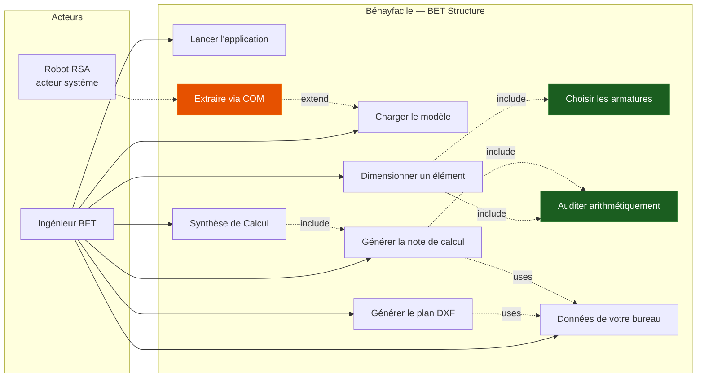

# Bénayfacile — Diagramme de cas d'usage et scénarios

> Portée : comportement fonctionnel observable de l'application (lanceur +
> 4 microservices + tableau de bord). Le moteur de calcul n'est pas décrit ici ;
> voir `docs/ARCHITECTURE_LANCEUR.md` pour l'architecture technique du lanceur.

## 1. Acteurs

| Acteur | Type | Rôle |
|---|---|---|
| **Ingénieur BET** | Humain | Seul acteur humain. Saisit les données, lance les calculs, émet les notes et plans. |
| **Robot Structural Analysis (RSA)** | Système | N'intervient que pour « Extraire via COM ». Sans Robot, « Charger le modèle » bascule sur le scénario de simulation R+4. |

## 2. Diagramme de cas d'usage (Mermaid)

**Lecture :**

- « include » (vert) : comportement **toujours** exécuté — chaque dimensionnement
  passe par `choisir_barres()` et chaque note contient l'audit arithmétique
  ligne à ligne.
- « extend » (orange) : comportement **facultatif et conditionnel** — la flèche
  part de l'extension vers le cas de base (convention UML).

## 3. Ce qui ne correspond pas encore à la réalité [Confirmé]

| Élément | État réel |
|---|---|
| « Lancer l'application » via `.exe` | **Pas encore livré** : `build_exe.bat` n'a pas été exécuté. Aujourd'hui, lancement par `bnayfacile_app.py` ou `run_services.bat`. |
| « Générer le plan DXF » | Ne trace que les **fondations** : plan d'implantation, tableau des semelles, cartouche. Le ferraillage DXF des poteaux/poutres, annoncé par l'analyse inverse initiale, n'est pas construit. |
| « Semelles Filantes » | Implémenté sous « Dimensionner un élément », mais **absent du scénario démo** R+4. |
| Ferraillage poteau en vue DXF | Non implémenté (détail poteau = cadre + 4 aciers symboliques). |

## 4. Scénarios détaillés

### UC1 — Lancer l'application

- **Préconditions** : machine Windows ; ports 8001-8004 et 8090 libres (ou `run_services.bat` arrêté).
- **Flux principal** : double-clic `Benayfacile.exe` (ou `python bnayfacile_app.py --no-browser`) → les 5 serveurs démarrent dans un seul processus → le navigateur s'ouvre sur `http://127.0.0.1:8090`.
- **Flux alternatifs** :
  - un port est occupé → message « Port(s) déjà utilisé(s) : … » → **aucun** serveur démarré, sortie code 1 ;
  - l'exe n'a jamais été construit → lancer par les sources (`bnayfacile_app.py` / `run_services.bat`).

### UC2 — Charger le modèle

- **Préconditions** : application lancée ; onglet « Vérification Sismique ».
- **Flux principal** : bouton « Charger le modèle Robot » → `GET /api/robot/model` → réponse modèle (niveaux, Wi, G/Q, T1) → pré-remplissage G/Q.
- **Flux alternatifs** :
  - Robot non installé ou extraction COM en échec → bascule automatique sur le **scénario R+4** (zone 3, site S2, classe II, K = 2,0) avec avertissement affiché ;
  - `POST /api/robot/model { forcer_simulation: true }` → idem, sans tentative COM.

### UC3 — Extraire via COM (extend UC2)

- **Préconditions** : Robot installé, projet ouvert.
- **Flux principal** : `robot_service` instancie `Robot.Application` via `win32com` → lecture nodes/bars/panels/cases/combinaisons → renvoi du résumé (mode = `robot`).
- **Flux alternatif** : COM indisponible ou projet absent → exception → fallback simulation (UC2 alternatif).

### UC4 — Dimensionner un élément

- **Préconditions** : données matériaux saisies (fc28, fe) ; repère de section ; onglet module actif.
- **Flux principal** : saisir les données → « Calculer » → moteur BAEL/RPS → **audit arithmétique** ligne à ligne + **choisir_barres()** → affichage des résultats → « Ajouter à la synthèse ».
- **Flux alternatifs** :
  - entrée invalide (section trop petite, λ > 70, σmax > σsol) → calcul refusé/flagué, message d'alerte rouge ;
  - semelle : poinçonnement non satisfait → **H augmenté automatiquement** par pas de 5 cm (max 1,5 m), signalé dans la note ;
  - poutre : μ > μlim (0,372 FeE500 / 0,392 FeE400) → bascule « aciers comprimés », As′ calculés ;
  - poutre ELS : σst ou σbc dépassé → case rouge dans le résultat.

### UC5 — Choisir les armatures [include UC4]

- **Préconditions** : section d'acier requise (cm²) connue.
- **Flux principal** : `choisir_barres(as_requis)` → essai des Ø 8→32 mm, barres paires si symétrique → retour `n HAØ` + section fournie + écart en %.

### UC6 — Auditer arithmétiquement [include UC4 / UC7]

- **Préconditions** : résultats de calcul disponibles.
- **Flux principal** : recalcul externe de chaque formule (Mu, Nu,lim, As, σ, Q×P=T) → comparaison avec l'écart → **OK** ou **`[ALERTE ECART ARITHMETIQUE]`**.

### UC7 — Générer la note de calcul

- **Préconditions** : au moins un élément ajouté à la synthèse ; données du bureau renseignées (page de garde).
- **Flux principal** : onglet « Synthèse de Calcul » → renseigner projet/client/site → « Générer la note de calcul » → `report_service` produit la note HTML A4 (page de garde, références BAEL/RPS, hypothèses, modèle, modules, audit ligne à ligne) → nouvel onglet → impression PDF depuis le navigateur.
- **Flux alternatifs** :
  - synthèse vide → note émise avec sections « aucun … calculé » + avertissements ;
  - « Sauvegarder la note » → copie dans `output/note_de_calcul_*.html` sans ouvrir d'onglet.

### UC8 — Générer le plan DXF

- **Préconditions** : données du bureau renseignées (cartouche) ; au moins une semelle en synthèse (sinon valeurs démo).
- **Flux principal** : bouton « Générer le plan DXF » → POST `/api/dxf/generate` (trame 0-6-12 × 0-5-10 par défaut) → 9 semelles dessinées sur calques `AXES/COFFRAGE/ACIER_LONG/CADRES/COTATION/CARTOUCHE` → lien de téléchargement du `.dxf`.
- **Flux alternatifs** : aucune semelle en synthèse → plan généré avec A=B=2,27 m par défaut + avertissement ; semelles en synthèse → cotées aux intersections par défaut (modifiable via JSON customisé).

### UC9 — Données de votre bureau

- **Préconditions** : application lancée ; onglet « Données de votre bureau ».
- **Flux principal** : modifier nom/adresse/tél/ICE/RC/patente → « Enregistrer » → `PUT /api/bureau` → `referentiels/bureau.json` réécrit (mode sources) ou conservé (mode exe — jamais écrasé au lancement) → reprises dans la page de garde et le cartouche.
- **Flux alternatif** : champs vides → sauvegardés tels quels (pas de validation bloquante aujourd'hui).

### UC10 — Synthèse de Calcul

- **Préconditions** : application lancée ; éventuellement des éléments déjà calculés.
- **Flux principal** : agréger modèle + sismique + modules → afficher le récapitulatif (comptages, valeurs clés) → boutons « Générer la note » / « Sauvegarder la note » / « Générer le plan DXF ».
- **Flux alternatif** : bouton « Charger le scénario démo R+4 » → pré-remplit tout (Robot simulation + sismique + 1 élément de chaque module).

## 5. Correspondance cas ↔ implémentation

| Cas | Endpoint | Fichier |
|---|---|---|
| Lancer | `python bnayfacile_app.py` | `bnayfacile_app.py`, `launcher/` |
| Charger le modèle | `GET /api/robot/model` | `services/robot_service.py` |
| Extraire via COM | `POST /api/robot/extract` | `services/robot_service.py` |
| Dimensionner | `/poteau` `/poutre` `/semelle` `/semelle_filante` `/voile` `/sismique` | `services/engine_service.py` |
| Note de calcul | `POST /api/report/note` `POST /api/report/note/save` | `services/report_service.py` |
| Plan DXF | `POST /api/dxf/generate` `GET /api/dxf/download/{nom}` | `services/dxf_service.py` |
| Données bureau | `GET/PUT /api/bureau` | `gateway/app.py` |
| Proxy tableau de bord | `/api/{service}/*` | `gateway/app.py` |
| Synthèse | (client) | `gateway/static/app.js` |
